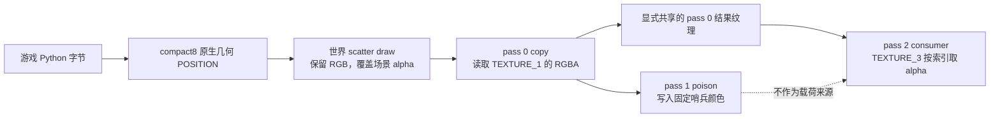

# 原生几何 → 共享数据纹理 → shader 索引取数

后续的容量扩展、固定名称双缓冲、连续更新性能和运行中像素抽查见[容量与连续更新研究](GEOMETRY_ATLAS_STREAMING_RESEARCH.md)。本页保留 a1–a3 阶段的 64 KiB 基线证据；其容量保护值和静态性能不能直接代替后续动态测试结论。

本轮已在本机实机跑通新的数据通路：**游戏 Python 生成字节，经原生建筑几何写入场景颜色缓冲的 alpha，再复制成显式连接给 consumer 的纹理；consumer fragment shader 可按计算索引读取字节，并完成“第一次读出的字节决定第二次地址”的两次依赖取数。** a3 对默认隐藏 HUD 的渲染配置冷启动，已完成 **64 KiB 全量驻留与五项对照**，独立审计通过；其后 8 秒静态测量中，全量每帧 scatter、三 pass 和 4,096 格 dependent 取数的平均 `GetFps()` 为 60.0549，28 个样本。该测量不包含每帧 Python 重建或上传 64 KiB。其后增加的失败重试与清理加固仅完成单元回归，未并入这次冷启动验证。

这补上了[紧凑几何编码研究](GEOMETRY_PACKET_COMPACT_RESEARCH.md)中“primitive 只能使用自身记录”的限制。这里建立的是指定后处理 consumer 的 fragment 取数能力；没有验证 vertex shader 随机访问、所有 UI／材质自动获得该纹理、GPU → 游戏 Python 回读或跨帧持久 GPU 状态。

小型归档入口为[结果摘要](evidence/geometry-atlas/summary.json)、[a2 独立复核](evidence/geometry-atlas/independent-a2.json)及[a3 独立复核](evidence/geometry-atlas/independent-a3.json)。原始构建、调用命令、receipt、720×1080 原生 PNG、逐窗 oracle 和失败保留于 `.runtime/geometry-atlas-study/`。a2 的 256 B、3 KiB 与隐藏 HUD 后的 12 KiB 样例也已通过；该目录的独立审计确认 4 个 case 全部与证据一致，3 个成功、1 个 HUD 影响下的失败保留。a3 固化默认隐藏 HUD，并单独验证最终资源冷启动。

## 数据实际经过的路径

探针为独立生成的行为包／资源包。游戏 Python 通过 `DeserializeBlockPalette` 与 `CombineBlockPaletteToGeometry` 创建 compact8 几何，使用每代新名称，再通过 `AddActorBlockGeometry` 挂到透明的客户端 BB 模型 anchor。anchor 在世界中提交 draw，scatter vertex shader 直接输出 atlas 所需的 clip-space 坐标，不依靠它在截图中的投影位置排布数据。



世界 scatter 使用[compact8](GEOMETRY_PACKET_COMPACT_RESEARCH.md#compact8-如何减少-palette-包围体)：高 4 位存整数 block Y，低 4 位选 16 个静态局部平面。每字节仍为一个 quad。此次世界 attachment 的原生位置需要加 `(0.5,0.5,0.5)`，才能恢复 palette 原坐标；它与前一 PaperDoll 路径的半体积居中不同。scatter 从还原后的 Y 解码 `16*floor(y)+floor(16*fract(y))`，由 X/Z 恢复 slot，再将该 slot 写入 atlas 的固定小格。

| 阶段 | 实际读写 | 使数据路径成立的设置 |
| --- | --- | --- |
| 世界 scatter | 原生 `POSITION` → 场景 alpha | 默认材质 `DisableRGBWrite`；RGB blend 为 `Zero/One`，alpha 为 `One/Zero`，移除 `DisableAlphaWrite` 与 alpha-to-coverage；关闭深度测试、写入与背面剔除 |
| pass 0：copy | `texture2D(TEXTURE_1,uv)` 完整 RGBA → pass 0 render target | 复制场景原始颜色缓冲，包括 alpha；没有把值改成期望字节 |
| pass 1：poison | 输出固定 `(1,0,1,0.25)` | 使紧邻 consumer 的上一 pass 结果与 payload 明确不同 |
| pass 2：consumer | 从 `TEXTURE_3` 的 alpha 取字节 → 输出灰度 RGB、alpha 1 | 显式连接 pass 0 → pass 2 的槽位 3；sampler 1、3 均为 Point／Clamp |

关键连接是公开 API：

```python
post.PostPassResultToOtherPass(process_name, 0, process_name, 2, 3)
```

通过 MCP 查询的接口说明明确：源 pass 必须在目标 pass 之前执行，源与目标可以属于同一 process，目标纹理槽位为 3–7；槽位 0 为上一 pass 颜色、1 为未后处理原始颜色、2 为深度。此探针把不相邻的 pass 0 结果绑定到 pass 2 的 `TEXTURE_3`。所有成功 case 都记录 `connection=true`、`direct_source=false`、`payload_channel=alpha`，因此成功载荷来自显式共享的复制结果。

默认 scatter 虽然输出 `(byte,byte,byte,byte)`，材质只允许 alpha 承载该字节，并保留已有 RGB。a3 的 v3 原生对照先固定天空视角，关闭后处理，再分别隐藏／显示 writer；两张原生 PNG 的整个 atlas ROI `[left=8,top=64,right=520,bottom=576]` 共 **262,144 个像素 RGB 全部相同，最大通道差为 0**，详见下文。**这不是 RGBA 四通道各存一个独立字节。** consumer 以 `floor(alpha*255+0.5)` 恢复整数。RGB 写入、直接采样原始 `TEXTURE_1`、取 red 通道和源 RGB 展示均为诊断分支，不能替代默认 alpha／共享复制纹理的通过证据。

## 可计算索引与两次依赖取数

设当前驻留载荷为 `B[0..N-1]`，`j` 是 query 起点加当前输出格序号。consumer 中实现并验证了以下三种 payload 模式：

| 模式 | shader 计算与返回值 | runner 使用的参数 |
| --- | --- | --- |
| identity | 返回 `B[j]` | mode 0，salt 0，salt2 0 |
| permutation | `k=(131*j+salt) mod N`；返回 `B[k]` | mode 1，salt 17 |
| dependent | `k=(131*j+salt) mod N`；先读 `first=B[k]`，再算 `i=(k+257*first+salt2) mod N`；返回 `B[i]` | mode 2，salt 97，salt2 53 |

dependent 的第二次地址确实依赖第一次纹理采样读出的 byte，没有 CPU 为每个输出格预先送入地址。shader 接收的 uniform 只有 query、mode、salt、布局、屏幕尺寸、方向和控制标志；**没有 seed、generation、payload 副本或期望字节，也没有 PRNG。** 宿主 oracle 独立用整数算法重算 `B[k]` 与第二次地址，既不读取图像来决定期望地址，也不从 receipt 的 CPU 字节副本获取期望值。

源 atlas 的一个 slot 映射到小格中心：

```text
column = index % atlas_columns
row = index // atlas_columns
pixel = (left,top) + (column+0.5,row+0.5)*cell_px
uv = pixel/(720,1080)                 # 已验证的后处理采样需要翻转 Y
```

Point 采样避免邻格插值。当前 `N<=65536` 也为 `131*j+salt` 的 highp 整数计算提供保护范围；这不是所有设备浮点行为的保证，仍需原生像素 oracle 检查。identity 与 permutation 遍历全部 query ordinal 时可覆盖全部源 slot；131 与载荷长度互质是 permutation 的前提，runner 会拒绝不满足条件的长度。

dependent 的二次地址会碰撞，因此“全 query 覆盖”不等于“所有二次源地址均访问”。a2 成功样例中，dependent 分别访问 167／256、1,970／3,072、7,806／12,288 个不同二次源地址；a3 的 64 KiB 则为 41,484／65,536。其每个 query 输出都验证通过；全部驻留数据另由 identity 与 permutation 的完整源覆盖证明。

## a2 已完成的原生对照

全部使用 720×1080 原生物理客户区与 WGC PNG，源 atlas 采用 alpha，consumer 读取共享 `TEXTURE_3`，Y 翻转开启。每个 query 最多显示 4,096 格，输出固定在 `[x=0,y=64,width=720,height=1000]`。宿主逐格检查完整 3×3 RGBA patch：RGB 逐通道精确等于期望 byte，alpha 必须为 255，容差为零；不缩放、不偏移搜索、不自动裁切。

| 原始 case | 驻留载荷 / 源 atlas | identity / permutation / dependent | 隐藏 writer 反例 | generation 2 新代通过且旧代 oracle 被拒绝 | 结论 |
| --- | --- | --- | --- | --- | --- |
| [`alpha256`](../.runtime/geometry-atlas-study/a2/alpha256.atlas.json) | 256 B；16 列、4 px／格 | 全部通过，各 1 窗 | 通过：隐藏后不再匹配载荷 | 通过，全 256 slot | alpha 与共享复制纹理通路通过 |
| [`alpha3k`](../.runtime/geometry-atlas-study/a2/alpha3k.atlas.json) | 3,072 B；64 列、4 px／格 | 全部通过，各 1 窗 | 通过 | 通过，全 3,072 slot | 五项控制均通过 |
| [`alpha12k`](../.runtime/geometry-atlas-study/a2/alpha12k.atlas.json) | 12,288 B；64 列、4 px／格；原生 HUD 显示 | 三项均失败；每模式 3 窗、各 48 格 patch 失败 | 通过 | 新代画面仍有 48 格失败 | **失败保留**；不能计作通过容量 |
| [`alpha12k_hud_hidden`](../.runtime/geometry-atlas-study/a2/alpha12k_hud_hidden.atlas.json) | 12,288 B；同布局；调用 `HideHudGUI(True)` | 全部通过，各 3 窗 | 通过 | 通过，全 12,288 slot | 隐藏 HUD 后五项控制均通过 |

每项正向序列冻结 seed、generation、geometry 名称、build serial、布局和 upload history。只改变 query 起点与索引控制，不重新 Combine 或上传较小载荷。跨窗要求身份不变、query ordinal 不缺不重。generation 2 则明确创建新几何名称、提高 build serial，再验证新图；同一张新代截图必须被上一代 oracle 拒绝。这样不能用“换了 generation 标签”把旧数据判成正确。

隐藏 writer 通过 uniform 将全部 scatter primitive 移出 clip 范围，几何身份仍不变；此时要求当前载荷 oracle 失败。它是“关闭真实生产者会切断结果”的反例，不能把隐藏后的失败截图计作数据成功。poison pass 另负责区分共享复制结果与上一 pass 的常量结果。两项控制与新旧代对照共同支持真实的数据来源。

3 KiB 和隐藏 HUD 的 12 KiB 成功序列中，实际校验到全部 0–255 字节值，包含 0 与 255，均精确通过。256 B 初始 PRNG 样本只有 171 种值，不能把小样例单独说成对所有 256 个值的穷举。

[a2 原始独立审计](../.runtime/geometry-atlas-study/a2/independent-verification.json)重新读取所有 receipt、原生 PNG、命令及捕获身份，重算索引和完整 patch，并记录文件 SHA-256。这里的“独立”指独立于游戏内数据生产者的离线证据重放；审计工具与 runner 共用 `verify_capture` 的 oracle 实现，并非第二套像素算法。结果为 `audit_passed=true`、4 case 一致、3 case 成功、1 个源失败保留。总体 `final_payload_passed=false` 正是因为 `alpha12k` 失败仍在，不能通过删除该 case 获得全部绿色。

## a3 冷启动的 64 KiB 全量验证

[`alpha64k`](../.runtime/geometry-atlas-study/a3/alpha64k.atlas.json)使用已固化默认隐藏 HUD 的构建版本，驻留 65,536 字节，源 atlas 为 256 列、每格 2 px，左上 `(8,64)`。从 generation 1 开始，完成前三项查询和隐藏 writer 反例，再以新名称上传 generation 2。两代分别为 build serial 1、2；所有查询窗口都维持对应的原生几何身份和冻结载荷。

| 控制 | 原生截图数 | 完整结果 |
| --- | ---: | --- |
| generation 1 identity | 16 | 全 65,536 个源 slot 精确通过，589,824 个 patch 像素 |
| generation 1 permutation | 16 | 全 query 与全部源 slot 精确通过 |
| generation 1 dependent | 16 | 全 query 精确通过；41,484 个不同二次源地址 |
| 隐藏 writer | 1 | 当前载荷 oracle 按预期失败，反例通过 |
| generation 2 identity／旧代 oracle | 16 | 全 65,536 slot 新代通过；同一组 16 张图分别均被旧代 oracle 拒绝 |

合计 **65 张原生 PNG**。旧代反例复用新代截图，没有另外计入 16 张图。所有正向序列都覆盖全部 0–255 值，最大误差为 0；源 geometry 在每个序列跨窗保持不变。[a3 原始独立审计](../.runtime/geometry-atlas-study/a3/independent-verification.json)得到 `audit_passed=true`、`case_count=1`、`passing_cases=1`、`preserved_source_failures=0`、`final_payload_passed=true`。该审计独立于游戏数据生产者，与 runner 共用像素和索引 oracle，不构成双实现审计。这一新增成功不删除或改写 a1/a2 的失败历史。

## 原生 RGB 保持对照

最终采用 v3 这一组证据：[setup receipt](../.runtime/geometry-atlas-study/a3/rgb_sky_setup_v3.state.json)记录 `SetCameraRotation((75,0,0))` 返回成功、writer 隐藏；[writer receipt](../.runtime/geometry-atlas-study/a3/rgb_sky_writer_v3.state.json)记录同一 generation 2／同一 geometry 显示 writer。两次都关闭后处理，以固定天空避开动态场景干扰；比较的是[隐藏 writer](../.runtime/geometry-atlas-study/a3/rgb_sky_baseline_v3.png)与[显示 writer](../.runtime/geometry-atlas-study/a3/rgb_sky_writer_v3.png)两张 720×1080 原生 PNG 的 RGB。

ROI 的边界为 `[8,64,520,576]`，即 512×512 个像素，覆盖当前 64 KiB atlas 的全部源格。逐像素比较结果为 262,144／262,144 相同，变化像素 0，最大通道差 0。[v3 比较记录](../.runtime/geometry-atlas-study/a3/rgb-preservation-v3.json)单独保留这次固定视角与原始文件身份。

初次 `rgb_baseline.png`／`rgb_writer.png` 在同一 ROI 内有 11,941 个像素变化；两帧可见史莱姆从约 x=93 移到 x=265，场景并未保持静止。这组图既不能证明材质保持 RGB，也不能据此判定 RGB 保持失败；原始图与后续 v2 记录保留，均不作为最终受控结论。v3 固定天空后重做，避免将动态物体移动归因为 writer 改变覆盖关系。

随后重新启用后处理，仍使用 generation 2、同一 geometry 和 build serial 2，执行 `[0,4096,2,97]`、salt2 53 的 dependent query。[`post_measure_dependent_v3`](../.runtime/geometry-atlas-study/a3/post_measure_dependent_v3.verify.json)全部 4,096 格、36,864 个 patch 像素精确通过，最大误差 0。这确认相机转动之后 writer 仍在实际供数；RGB 相同不是因 writer 未生效而获得的空对照。这一补充仅为一个窗口，64 KiB 的完整覆盖仍以正式 65 张图的 case 为准。

## HUD 失败、世界位置校准与迭代记录

`alpha12k` 每个 4,096 格窗口都在输出 ordinal 4,056–4,071 出现同一小段 16 格错误，三个窗口合计 48 格。更换 query 并没有移动该屏幕错误区域；调用原生 `HideHudGUI(True)` 后，以新 case 重做全部控制均通过。这支持后处理结果在后续 HUD 合成时被覆盖的解释。它不证明源 atlas alpha 在该次失败中已经损坏，也不能据此宣称 12 KiB 触及容量上限。

当前实现的 `open()` 默认隐藏原生 HUD，`close()` 在本探针设置过隐藏状态时调用 `HideHudGUI(False)`；runner 同时隐藏原生准星。这是隔离实验所需的画面条件。恢复动作是显式显示 HUD，尚未实现对用户先前任意 HUD 状态的精确保存与还原，不能据此声称对通用游戏 UI 无副作用。

| 迭代证据 | 观察与修正 | 能保留的结论 |
| --- | --- | --- |
| [`a1/alpha256`](../.runtime/geometry-atlas-study/a1/alpha256.atlas.json) | 依赖 `__file__` 定位生成模块的配置不可用，最终相对路径 `pipeline.json` 读取失败；生成器改为导入常量模块 `pipeline_config.py` | 后处理尚未安装，不能判断数据通路或容量 |
| [`a1/alpha256_retry`](../.runtime/geometry-atlas-study/a1/alpha256_retry.atlas.json) | pipeline 装载后仍使用错误的世界源坐标恢复；payload 各模式失败 | 原始失败保留，不能将它改写为成功 |
| [`a1/center_zero_v1`](../.runtime/geometry-atlas-study/a1/center_zero_v1.verify.json) 与 [`center_half_v1`](../.runtime/geometry-atlas-study/a1/center_half_v1.verify.json) | 同一 256 B 校准，中心补偿 `(0,0,0)` 有 254 格失败；改成 `(0.5,0.5,0.5)` 后 256 格全部精确通过 | 支持此世界 attachment 的半方块补偿；不能沿用 PaperDoll 半体积规则 |
| a2 冷启动 | 固化生成的 pipeline 配置和半方块补偿；256 B、3 KiB 五控制通过 | 从冷启动而非仅热修运行确认通路 |
| a2 12 KiB HUD 对照 | 原 case 失败；手动隐藏 HUD 后新 case 五控制通过 | HUD 影响与载荷正确性分开记录 |
| a3 渲染配置冷启动 | 固化 `open()` 隐藏 HUD；完成 64 KiB 全序列、独立审计与 8 秒静态性能测量 | 全量驻留与 fragment 索引取数通过；静态负载接近本次 60 FPS 配置上限 |

收尾另加了两项失败路径保护：单调递增的 `native_attempt_serial` 在原生创建尝试前消耗名称，避免 Combine／attachment 等失败后重试复用候选名称；`close()` 即使关闭后处理失败仍清理 anchor、恢复 HUD，`Destroy()` 通过 `finally` 注销事件。这些改动已完成单元回归。a3 冷启动早于该加固，成功路径与 shader 未变；因此本报告分别记录既有实机渲染证据与后续离线失败路径验证，不把后者描述成已经重新冷启动验收。

## 容量、每帧工作与性能边界

当前完成并审计的最大 atlas 载荷为隐藏 HUD 条件下的 **65,536 个同时驻留逻辑字节，即 64 KiB**。`MAX_BYTES=65536` 仍是本探针主动设置的输入／布局／索引精度保护；恰好验证到此值不代表发现引擎硬上限，更大档位没有测量。源布局左上为 `(8,64)`：256 B 使用 16 列、每格 4 px；大于 256 B 至 12 KiB 使用 64 列、4 px；更大至 64 KiB 使用 256 列、2 px。屏幕固定为 720×1080，因此上限同时受当前屏幕布局的约束；其他尺寸要另做验证。

数据几何在 query 扫描期间驻留，不重新上传，但 **每个渲染帧仍要 scatter 绘制全部 N 个数据 quad**，再执行三个全尺寸后处理 pass。4,096 是 consumer 的可见查询窗口上限，不是该帧只处理 4,096 个源 record。旧几何查询探针把窗口外记录裁掉的 256 KiB／约 60 FPS 结果不能转用于此通路；这里额外承担完整 atlas 写入、复制和 gather。

a2 snapshot 中的 `fps` 是单个 `GetFps()` 读数，没有完整计时样本序列，本报告不把它们列作稳定帧率。a3 使用 `start_measurement(seconds=8)` 单独测量：按 `GameRenderTickEvent` 记录事件间隔，预热 1 秒后每 15 个事件采一次 `GetFps()`。[原始测量 receipt](../.runtime/geometry-atlas-study/a3/measure64k_end.state.json)记录 generation 2、build serial 2、query `[0,4096,2,97]`、salt2 53、共享连接开启且 writer 可见，HUD 隐藏。

| a3 静态 64 KiB、4,096 格 dependent query | 实测 |
| --- | --- |
| 运行时长／渲染事件数 | 8.0006794 秒／480 |
| `GetFps()` 样本数／平均 | 28／60.054903 |
| `GetFps()` 最低／最高样本 | 59.760952／60.077515 |
| 预热后事件间隔样本数／平均 | 420／16.671844 ms |
| 事件间隔 p95 | 18.2482 ms |

该运行保持已载入的 64 KiB geometry，每帧绘制全部数据 quad、执行三个 pass，并对显示区的 4,096 个输出格执行 dependent 取数；**没有每帧 Python 生成或重建／上传 64 KiB。** 它没有 GPU fence，不测 GPU 完成时间，也不等同于[原研究](GEOMETRY_PACKET_COMPACT_RESEARCH.md#v6-高频更新对照)的全量 Combine 动态上传。测量期间没有逐帧保存并验证载荷，因此静态性能统计与冻结 query 的精确像素证据分别成立，不能合并成“每帧全部数据新鲜度通过”。这里只运行一个 8 秒样本，不外推为长期稳定性或其他设备性能。

会话仍使用每代新名称，主动保护最多 256 个 geometry 名称、累计 2,097,152 个逻辑 record，跨 dataset 不重置。该计数不是 VRAM、工作集或实际原生分配大小；隐藏旧模型不代表释放资源，没有已验证的原生回收或无限流式上传能力。

场景 alpha 是共享临时空间。其他世界对象、材质或渲染 pass 可能覆盖同一区域或改变 alpha；本轮只在隔离世界、固定 pipeline 和明确绘制状态下验证。复制后的结果可供显式连接的后续 fragment consumer 使用，尚没有向任意 JSON UI 图片暴露通用纹理资源、将其绑定给所有现有材质，或让它作为跨帧反馈状态的能力。本机为网易开发客户端 3.10、RTX 4060 Laptop GPU；结果不外推为所有 GPU、所有客户端、移动端或任意世界组合的保证。

## 实现与复现

代码位于 [`tools/geometry_atlas_probe/`](../tools/geometry_atlas_probe/)。[`build_probe.py`](../tools/geometry_atlas_probe/build_probe.py)生成独立包、16 个 compact8 模板、默认 alpha-only writer 材质与三 pass pipeline；[`runtime.py`](../tools/geometry_atlas_probe/runtime.py)负责世界 anchor、原生几何、uniform、共享纹理连接、HUD 条件和测量；[`scatter.vertex`](../tools/geometry_atlas_probe/scatter.vertex)将数据写入 atlas；[`consumer.fragment`](../tools/geometry_atlas_probe/consumer.fragment)执行索引取数；[`verify_capture.py`](../tools/geometry_atlas_probe/verify_capture.py)与[`recheck_evidence.py`](../tools/geometry_atlas_probe/recheck_evidence.py)负责独立像素和证据复核。

在仓库根目录使用未占用的生成目录、evidence 目录与 case 名称。构建后通过 [`host.py`](../tools/geometry_atlas_probe/host.py)冷启动本探针拥有的实例，owner 为 `manim-geometry-atlas`，不能复用旧 shader 的热修状态代替最终资源冷启动：

```powershell
python -B tools/geometry_atlas_probe/build_probe.py --output .runtime/geometry-atlas-study/project-repro
python -B tools/geometry_atlas_probe/host.py launch --project .runtime/geometry-atlas-study/project-repro --evidence .runtime/geometry-atlas-study/repro
python -B tools/geometry_atlas_probe/host.py resize --project .runtime/geometry-atlas-study/project-repro --evidence .runtime/geometry-atlas-study/repro --width 720 --height 1080
python -B tools/geometry_atlas_probe/run_case.py --project .runtime/geometry-atlas-study/project-repro --evidence .runtime/geometry-atlas-study/repro --name alpha3k --bytes 3072
python -B tools/geometry_atlas_probe/recheck_evidence.py --evidence .runtime/geometry-atlas-study/repro --output .runtime/geometry-atlas-study/repro/independent-verification.json
```

默认 runner 依次执行 identity、permutation、dependent、隐藏 writer、新 generation 并拒绝旧 oracle。12 KiB 可将 `--bytes` 改为 12288、选择新名称；64 KiB 使用 `--bytes 65536`，每个正向序列为 16 个窗口。每个 case 两次创建全量 geometry，预算不足时重启本 owner 的受管实例，保留失败与原始 receipt。

所有实机操作必须后台静默、noactivation 受保护并固定 60 FPS，使用原生 WGC 截图；后台条件丢失即停止，不通过激活或前台输入补完测试。仅对当前 owner／project 操作，不改动其他实例或产品资源。所有原始结果继续声明 `indexing_stage=fragment_consumer`、`vertex_random_access_verified=false`、`gpu_to_python_readback=false`、`all_render_frames_verified=false`、`actual_mobile_hardware=false`。宿主读取 PNG 做验证，不能描述成游戏内 GPU 回读接口。
