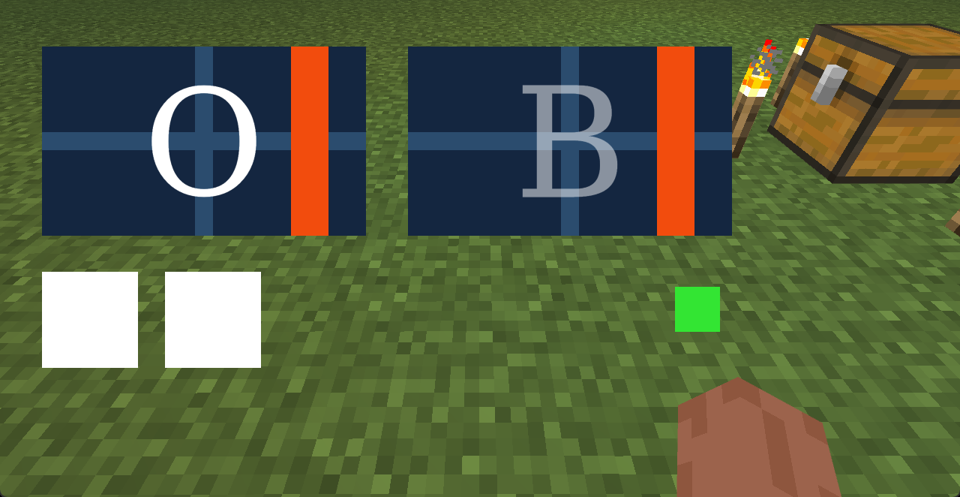
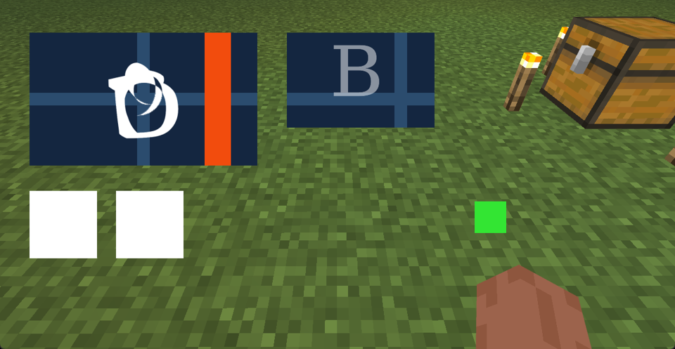
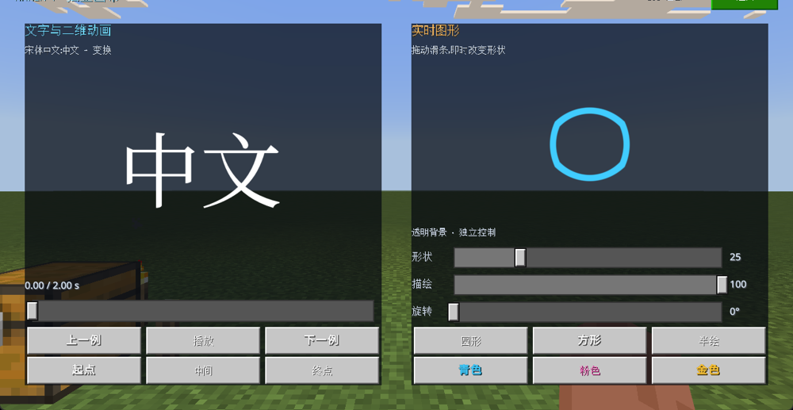

# 0.3.0 运行时与 UI 画布验收

记录日期：2026-11-10；项目记录时区 America/New_York。环境为 Windows 网易 3.10 开发客户端，受管后台实例，固定 60 FPS。所有交互由公开 SDK 或组件回调触发，没有前台鼠标键盘验收，也不代表手机验收。

## 路线结论

本版沿用静态文字、宋体与 LaTeX 编译，增加可复用播放接口、真正局部 UI 画布，以及同一预置 shader 消费实时参数的圆形／矩形图元。产品按开发计划 **B 分支**交付。

大批量动态数据实验属于 **C 分支的开发态证据**：已有纹理路径能读取游戏 Python 生成的新数据，但覆盖已加载纹理后需要全材质重载才能刷新；新路径未被识别，发布环境文件写入也未验收。本实验不能据此承诺任意运行时文字、系统字体解析或完整 LaTeX。尚未判定的其他公开数据入口不被描述为引擎绝对不支持。

## 数据通路实测

`tools/runtime_probe/` 使用游戏 Python 生成 128 个二维点，共 256 个 uint16 数值，编码成 16×16 PNG。16 位值分存 R/G，B=0；占位图 B=255。GPU 的同一份诊断 shader 展示编码格或解码后的点。宿主核对完整 256 格，不以接口返回 True 代替画面。

| 操作 | 实际画面 | 判定 |
| --- | --- | --- |
| 预置占位路径 | 蓝／紫占位图 | 材质与纹理槽有效 |
| 游戏启动后创建 `fresh_a`、`fresh_b` | 缺失纹理棋盘 | 新路径发现未通过 |
| 覆盖包启动时已有的 `overwrite`，在首次使用前写数据 | 256/256 格完全匹配，最大字节误差 0 | 开发态首次数据读取通过 |
| 再次覆盖同一路径，不重载 | 256/256 格仍匹配旧数据，新数据匹配 0/256 | 自动刷新未通过 |
| `ReloadAllShaders` 后 | 仍匹配旧数据 | shader 重载不刷新本实验纹理 |
| `ReloadAllMaterials` 后 | 256/256 格匹配第二份新数据，误差 0 | 依赖全材质重载的更新通过 |
| 全材质重载后再用新文件路径 | 仍是缺失纹理 | 未证明新增路径可发现 |
| 同一 shader 切到点绘制模式 | 出现游戏生成的 128 点分布 | 数据实际参与绘制，不只是显示图片 |
| 普通图片与 `RawPath`，包含 ASCII 路径复核 | 新文件仍显示缺失纹理；已有资源路径能显示编码图 | 任意图片入口未通过当前探针 |

两次全局重载调用都超出调试 IPC 等待期限；之后以只读状态检查和截图确认恢复，没有重放原调用。这不是可接受的逐帧／交互更新方案。没有精确记录重载结束时间，因此不提供虚构的单次重载耗时。

游戏内置 `hashlib` 没有 `sha256`。已改为游戏端记录 CRC32，宿主对保存的原始 PNG 另算 SHA-256；不把宿主生成数据冒充游戏生成。所有文件写入只发生在带所有权 marker 的隔离开发包内。该探针不随正式模组打包。

数值摘要见 [data-probe-summary.json](evidence/runtime-v030/data-probe-summary.json)。完整原始图、PNG 和回执保留在忽略目录 `.runtime/runtime-evidence/`。

## 独立画布探针

公开 `netease_paper_doll_renderer` 提供真实 UI 绘制调用；自定义顶点 shader 把平面 UV 映射到控件的屏幕矩形。`SetEntityUIExtraUniforms` 按实体 identifier 共享，所以本版明确限制为两个独立槽位，并为每个槽位／场景生成独立 identifier。

| 验证项 | 证据 |
| --- | --- |
| 两个区域独立时间／颜色／透明度 | 左侧 O、右侧半透明 B；改变左侧到中间态后，右侧矩形截图逐字节不变 |
| 透明背景 | 字形孔洞透出底纹，右侧半透明笔画透出十字底纹 |
| 前景遮挡 | 橙色高层控件覆盖画布 |
| 父区域裁剪 | 画布大于父区域时按边界裁剪 |
| 缩小画布与父区域 | 右侧缩小后仍正确定位，超出部分被裁剪 |
| 卸载 | `GetUI` 返回无实例，实图不再显示探针 |

探针只证明这一组实测条件。正式 Pyreact 组件的回归、版本包及性能结果见下节，不把探针与最终产品测试混为一谈。

## 保持画面的编译优化

编译器检查全部关键帧的曲线有效标记：始终有效的去掉纹理条件，始终跳过的曲线不生成代码，变化标记仍走原分支。纹理、时间、采样和填充语义不变。

| 场景 | 优化前 shader | 优化后 shader | 减少 |
| --- | ---: | ---: | ---: |
| 中文 → 变换 | 209,452 B | 184,871 B | 11.74% |
| 数学 → 中文 | 245,340 B | 216,459 B | 11.77% |

十个场景的纹理逐字节不变。新增桌面 OpenGL 回归比较旧动态分支与优化 shader，在五个端点／中间／切换时刻逐字节一致。源码体积下降不直接等于同等比例的加载加速；实机加载计时必须另外测量。

## 正式版本回归

- 参考环境完整离线测试：190 项，189 通过、1 跳过。跳过的是昂贵的全部十例桌面 GL 编译；本轮已单独运行通过，耗时约 217 秒，不在每次测试中重复。多层半透明合成、运行时任意参数、编译优化的图像一致性测试正常执行。
- 正式 UI 资源：十例各起点／中间／终点，共 30 帧，加任意实时参数图元一帧，共 31 帧。逐帧状态及截图检查通过，运行时图元 shader 前后哈希一致。
- 原后处理播放器：十例 30 帧、每例短时播放、暂停稳定、终点重播、页面清理和模拟 F8 回调重开通过。
- 两个画布时钟独立推进，暂停后位置不变；三轮关闭／重开均归还槽位并恢复原播放器。
- 1280×720 ↔ 640×360 后物理像素高度断言通过。最新故障恢复修正另实测 `hide → resize → show`，隐藏控件不再因原生尺寸为零导致永久无法初始化。
- 帧率短时采样约 60.08 FPS，符合设置 60 的计数误差容差。没有据此宣称连续长时无掉帧、手机通过或真实触摸命中通过。

完整回归摘要见 [verification-summary.json](evidence/runtime-v030/verification-summary.json)；十场景图见 [canvas-contact.png](evidence/runtime-v030/canvas-contact.png)。最终原始记录位于 `.runtime/verify-canvas-v030-delivery/` 与 `.runtime/verify-player-v030-final/`。

## 加载性能与保留限制

首次加载完整 UI 材质的实机启动仍出现数分钟等待。没有直接 GPU-ready 时间戳，也没有相同干净驱动缓存的对照，因此不将这次总等待归算为精确优化收益。

后处理首装的同步计时：`中文 → 变换` **90.214 秒**，`数学 → 中文` **83.464 秒**。首次调用超过调试 IPC 的等待上限后，通过只读状态查询确认成功，没有重复执行安装。加载后的画布选例 API 很快，但那是在原生资源已准备好的条件下；这两类指标分别记录。**冷加载问题未关闭**，下一次性能优化应优先减少展开曲线代码、控制加载场景集，并进行同条件首帧测量；不通过全面预热掩盖等待。

当前同屏最多两个画布；文字和公式是预置编译场景；任意系统字体 runtime、任意新文本／完整 TeX、复杂嵌套遮罩与移动平台仍未交付。SDK 返回失败后的显隐、暂停、错误状态与显式重试已有回归，不能等价于已制造并测试全部原生 GPU 故障。

## 交付包

`dist/pyreact-manim-ui-0.3.0-preview.mcaddon`：127 文件，1,794,972 字节；SHA-256 `d0ad940f97c5dd65df22ad28869b488c362c7074acfe5a1171b20ef2c3e1941b`。只包含正式 BP/RP；动态文件写入探针、宿主依赖、调试世界、日志与证据不打入安装包。

本轮保持后台静默与 60 FPS；测试结束关闭本项目自有实例，未操作其他会话的 MC，也不安排电脑休眠。
