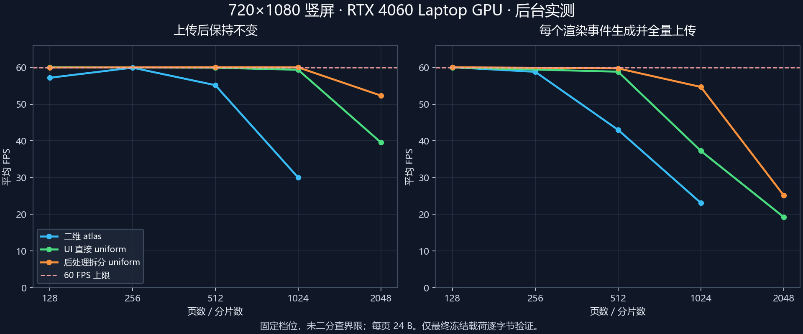

# 运行时 Python → shader 二维数据传输研究

2026-11-18 补充：[不借用场景 RGBA 的共享数组概念验证](ISOLATED_ATLAS_POC.md) 已完成 96 B、64 KiB、128 KiB 的完整原生读取与画面对照。后续按“大数组驻留、每帧预算更新”推进；旧版逐页汇聚的驻留成本仍需优化。

本轮在 **720（宽）×1080（高）物理客户区**中验证三条通路：二维后处理 atlas、直接 UI actor uniform、分散后处理 uniform。设备为 RTX 4060 Laptop GPU，网易客户端 `3.10.0.448891`，全程使用后台 noactivation 受管实例和原生 WGC 截图。本文记录的是桌面 PC 竖屏实机结果，尚未在手机硬件上测试。

**最大已验证单批为 8,192 页、196,608 字节，即 192 KiB，全部同时驻留。** 游戏 Python 写入每页八个 uint24，producer 将它们汇入二维 atlas，consumer 依次显示 64 个查询窗口，全部字节精确一致。这一最大档位动态基准约 **2.67 FPS**，不能作为大容量 60 Hz 数据上传方案。接近 60 FPS 的容量，应按下面的固定档位分别理解：

| 通路 | 静态实测的粗档位 | 每个渲染事件全量更新的粗档位 |
| --- | --- | --- |
| 二维 atlas，1 texel/word | 256 页／6 KiB：59.95 FPS → 512 页／12 KiB：55.18 FPS | 128 页／3 KiB：60.06 FPS，256 页／6 KiB：58.82 FPS → 512 页／12 KiB：43.02 FPS |
| 直接 UI uniform | 1,024 slots／24 KiB：59.38 FPS → 2,048 slots／48 KiB：39.58 FPS | 512 slots／12 KiB：58.86 FPS → 1,024 slots／24 KiB：37.27 FPS |
| 分散后处理 uniform，shared | 1,024 processes／24 KiB：60.03 FPS → 2,048 processes／48 KiB：52.35 FPS | 512 processes／12 KiB：59.75 FPS → 1,024 processes／24 KiB：54.70 FPS → 2,048 processes／48 KiB：25.17 FPS |

这些是本设备、本实现的**粗范围**，未二分搜索精确边界。约 59–60 FPS 是接近限帧值的测量波动，不以某个 59.x 数字划定刚性上限。atlas 的 128 页静态首测为 57.20 FPS，存在非单调波动；原值及未能完成复测的原因保留在后文。



图中按实测档位连接数据，仅用于比较趋势，不表示中间档位已测量；可另取 [SVG 图](evidence/runtime-packets2d/fps-comparison.svg)。

这里的“字节”均指 **uint24 编码的逻辑载荷**：一个 float 分量保存 `uint24 / 2^24`，两个 vec4 保存八个 word、24 字节。它没有提供原生 SSBO、任意 bytes buffer 或一次调用批量上传 API。UI 与 split 的总 uniform 分布在独立 identifier／process 的各次绘制中，不能把它们相加后宣称任意一个 shader 都能随机访问所有数据。二维 atlas 才把这些数据汇成 consumer 可索引的纹理，但需要额外 RT、整张 atlas 复制和大量 pass。

精简证据见 [summary.json](evidence/runtime-packets2d/summary.json)，离线独立复核见 [independent-verification.json](evidence/runtime-packets2d/independent-verification.json)。完整截图、命令、状态、逐字节报告和 case 回执保留在 `.runtime/runtime-packet-study2d/v1/`、`v2/`。研究实现和复现步骤见 [探针 README](../tools/runtime_packet_probe/README.md#portrait-2d-atlas-and-split-uniform-experiments)。这些是独立研究夹具，本轮未修改生产动画、生产资源包或播放接口。

## 测量条件与历史数据

| 条件 | 本轮记录 |
| --- | --- |
| 原生客户区与 WGC PNG | 宽 720、高 1080；两者一致，方向为 portrait |
| GPU | NVIDIA GeForce RTX 4060 Laptop GPU |
| 客户端 | `3.10.0.448891` |
| 窗口与输入 | 后台 noactivation；不激活、不恢复到前台，不使用桌面输入 |
| 配置帧率 | 60 FPS 上限，关闭无限帧率 |
| 无载荷基线 | v1：60.0363 FPS；v2：59.9247 FPS |
| 普通基准 | 12 秒，预热 1 秒；静态与动态分开测量 |
| 画面验证 | 冻结最后一代载荷，用原生 WGC 逐字节零容差检查 |

物理分辨率不是 `GetScreenSize()` 返回的逻辑 UI 尺寸，也不能把 720×1080 读作横屏。生成器的 `screen_size`、RT 比例和像素验证均按物理客户区计算。基线分别来自 [v1 baseline](../.runtime/runtime-packet-study2d/v1/baseline_end.state.json) 和 [v2 baseline](../.runtime/runtime-packet-study2d/v2/baseline_end.state.json)；配置上限与实际达到的帧率分别保留。

[上一轮报告](RUNTIME_PACKET_RESEARCH.md)中的约 20 FPS 基线，来自**用户睡觉期间主动设置的外部限帧**，不能归因为后台运行。旧报告保留原始条件下的单列 atlas 和分块 float32 数据；本文使用重新测量的约 60 FPS 基线，未把两轮性能混为一组。

## 三条数据通路实际提供什么

| 项目 | 二维 atlas | 直接 UI uniform | 分散后处理 uniform |
| --- | --- | --- | --- |
| 载荷入口 | 每个 producer 的两组 `SetParameter` vec4 | 每个独立实体 identifier 的两组 `SetEntityUIExtraUniforms` vec4 | 每个独立 process 的两组 `SetParameter` vec4 |
| 每页／slot 载荷 | 8 个 uint24，24 字节 | 8 个 uint24，24 字节 | 8 个 uint24，24 字节 |
| 完整更新的载荷调用数 | `2 × pages` | `2 × slots` | `2 × processes` |
| 消费方式 | producer 链汇聚纹理，consumer 按 page／word／byte 索引 | 每个 paperdoll 绘制自己的 tile | 每个 process 绘制自己的 tile，其余区域复制 `TEXTURE_0` |
| 配置中的绘制工作 | 每页一个 producer pass，加一个 consumer pass | 每 slot 一个 paperdoll 绘制；零 Image carrier、零后处理 pass | 每 process 一个全屏 pass；没有 atlas consumer 或显式连线 |
| 数据可见范围 | consumer 可索引完整汇聚纹理 | 当前独立绘制的 uniform | 当前独立 process 的 uniform及既有输入画面 |
| 本轮最大完整验证档位 | 8,192 页／192 KiB | 2,048 slots／48 KiB | shared 2,048 processes／48 KiB；distinct 1,024／24 KiB |

元数据参数、控件、实体资源和引擎内部开销不计入“逻辑载荷字节”。例如 8,192 页包含 65,536 个载荷标量分量，并非单个 program 具有 65,536 个 uniform。直接 UI 的 1,024 slots 同样是 8,192 个**分散的载荷分量**，每次全量更新调用 2,048 次 API。

shared 模式使用同一 shader／material 资源，distinct 为各 process 生成独立 shader／material 路径；两者均通过独立 process 名称寻址各自参数，局部参数名仍为 `tile`、`packet0`、`packet1`。distinct 证明的是资源路径及参数隔离方式不同；驱动仍可能去重相同代码，不能据此断言物理 program 或机器码完全独立，更没有扩大单个 shader 的 uniform 容量。

## 二维 atlas：大容量与布局

上一轮单列布局容易触及客户区高度，本轮将每页八个 word 排成横向八格，再把页排成二维网格。producer U1 存 `[page_index, page_count, columns, rows]`，U2/U3 存载荷，U4 留给客户端的 `ScreenInfo`。consumer 接收查询和布局参数，从最终 atlas 读取选定页。每个 word 的三个字节保存在 RGB；显示验证时展开为 24 个灰度 byte cell。

布局按 `uv.y=0` 起始的行优先顺序生成，不丢弃尾页、不把超出的逻辑格裁掉。生成器允许每 word 使用边长分别为 4、2、1 texel 的方格；本轮 dense 档位固定 1 texel/word。RT 比例使用 `(目标像素 + 0.25) / 客户区像素` 的微小偏置，避免 float32 比例在整像素分配处向下舍入。下表尺寸是生成配置与回执记录的目标尺寸；全部逻辑页均由实际输出逐字节验证。

| 案例 | 页数 | 载荷标量分量 | 逻辑载荷 | 页网格（列×行） | RT 目标像素 | 每 word 的格边长 | 验证窗口数 | 静态 FPS | 动态 FPS |
| --- | ---: | ---: | ---: | --- | --- | ---: | ---: | ---: | ---: |
| `v1/atlas2d1024_*` | 1,024 | 8,192 | 24,576 B／24 KiB | 9×114 | 288×456 | 4 | 8 | 29.70 | 19.97 |
| `v1/dense1024_*` | 1,024 | 8,192 | 24,576 B／24 KiB | 9×114 | 72×114 | 1 | 8 | 30.03 | 23.11 |
| `v1/dense4096_dynamic` | 4,096 | 32,768 | 98,304 B／96 KiB | 19×216 | 152×216 | 1 | 32 | 未测 | 6.33 |
| `v1/dense8192_dynamic_retry` | 8,192 | 65,536 | 196,608 B／192 KiB | 26×316 | 208×316 | 1 | 64 | 未测 | 2.67 |

上述各静态／动态成功案例均有 `exact_equal=true`、`verified_pages=pages`、`all_resident_bytes_verified=true`。另有四页、96 字节 smoke 验证通过，未做性能基准。`MAX_PAGES=16384` 只是宿主生成器分配保护值，16,384 页未在本轮实机测试，不能把它当成引擎容量上限或成功结果。

**8,192 页的 64 次显示并非 64 批轮流替换载荷。** 计时结束后停止更新，全部 8,192 页继续同时驻留；各窗口只修改 consumer 的查询起点，runner 检查窗口之间冻结载荷未变，再汇总全部页的覆盖和哈希。因此它证明单批 192 KiB 的可访问性，而不是累计传输了 192 KiB。

关键完整回执与合并摘要为：

| 案例 | 观察值与独立期望值共同的 SHA-256 |
| --- | --- |
| [4,096 页](../.runtime/runtime-packet-study2d/v1/dense4096_dynamic.case.json) | `1fed0b684fbeb6591e5b19a51d2617aebd1cfe664439db5a2a3c42c86cf61be0` |
| [8,192 页](../.runtime/runtime-packet-study2d/v1/dense8192_dynamic_retry.case.json) | `46231ac74fa1f9075843709a17ee40de0aeb2bc5a10f1623be5dd2668cd39369` |

将 1,024 页从 288×456 缩至 72×114 后，动态 FPS 由 19.97 提升至 23.11，静态仍约 30 FPS。减小 RT 有收益，但本实现仍需要 1,024 个 producer、1 个 consumer，并在 producer 链中复制 atlas。8,192 页则需要 8,193 个配置 pass、每次更新 16,384 次载荷调用。帧率与 CPU 数据不足以把成本精确分解到 GPU 拷贝、驱动或引擎调度，不将这些观察扩张成单一根因。

## 二维 atlas：接近 60 FPS 的固定档位

本轮按预定的 128／256／512／1,024 页观察粗范围，不二分逼近精确上限。下表全部为 dense 1 texel/word；1,024 档沿用同物理分辨率、相同 dense 路线的 v1 记录，其余为 v2。

| 页数 | 载荷标量分量 | 逻辑载荷 | 网格／RT 目标像素 | 静态 FPS | 动态 FPS | 完整验证 |
| --- | ---: | ---: | --- | ---: | ---: | --- |
| 128 | 1,024 | 3,072 B／3 KiB | 3×43／24×43 | 57.20† | 60.06 | 两者全部 128 页通过 |
| 256 | 2,048 | 6,144 B／6 KiB | 5×52／40×52 | 59.95 | 58.82 | 两者全部 256 页通过 |
| 512 | 4,096 | 12,288 B／12 KiB | 7×74／56×74 | 55.18 | 43.02 | 两者全部 512 页通过 |
| 1,024 | 8,192 | 24,576 B／24 KiB | 9×114／72×114 | 30.03 | 23.11 | 两者全部 1,024 页通过 |

† 128 页静态首测低于同档动态及 256 页静态，是应保留的非单调结果，原因未确认。计划进行的一次复测被后台窗口保护拒绝：当时 owned 游戏窗口不可用，guard 返回 `windows=[]`；未激活或恢复窗口，未得到新的测量。拒绝记录见 [coarse128_recheck_blocked.json](../.runtime/runtime-packet-study2d/v2/coarse128_recheck_blocked.json)，原始观察见 [background_at_recheck.json](../.runtime/runtime-packet-study2d/v2/background_at_recheck.json)。不能把 57.20 FPS 写成“128 页就是容量极限”，也不能删除首测后把它改写为稳定 60。较清晰的静态粗范围是 256 页约 60 → 512 页约 55；动态从 128 页约 60、256 页约 59，下降到 512 页约 43。

原始 case 名为 `v2/coarse_dense{128,256,512}_{static,dynamic}.case.json`，例如 [128 静态](../.runtime/runtime-packet-study2d/v2/coarse_dense128_static.case.json)、[256 静态](../.runtime/runtime-packet-study2d/v2/coarse_dense256_static.case.json)、[512 动态](../.runtime/runtime-packet-study2d/v2/coarse_dense512_dynamic.case.json)。这组结果衡量该 atlas 实现及全量更新成本，不能转换为所有 shader、所有设备的通用 uniform 上限。

## 直接 UI uniform：分散载荷可明显多于旧 carrier 路线

本路线不创建透明 Image carrier，直接为独立实体 identifier 写入两组 actor uniform，由 paperdoll shader 绘制对应 tile。每个 slot 有自己的父 panel；每张 screen 最多 64 个 slots，多张 screen 分别在不同渲染轮次创建，等待前一张 screen 的 `Create` 回调完成后再创建下一张。

这解决的是本夹具的资源组织与创建方式。旧报告中 256／1,024／4,096 carrier 在首次 UI 创建失败，不能据此否定新路线，也不能反过来把这次 2,048 slot 成功当成官方控件上限或通用规避方式。

| slots／独立 identifiers | 载荷标量分量 | 每次全量载荷调用 | 逻辑载荷 | tile 网格（列×行） | screens（每张 64 slots） | 静态 FPS | 动态 FPS | 冻结画面验证 |
| --- | ---: | ---: | ---: | --- | ---: | ---: | ---: | --- |
| 128 | 1,024 | 256 | 3,072 B／3 KiB | 2×64 | 2 | 60.07 | 60.00 | 静态／动态全 128 slots，通过 |
| 512 | 4,096 | 1,024 | 12,288 B／12 KiB | 4×128 | 8 | 59.94 | 58.86 | 静态／动态全 512 slots，通过 |
| 1,024 | 8,192 | 2,048 | 24,576 B／24 KiB | 5×205 | 16 | 59.38 | 37.27 | 静态／动态全 1,024 slots，通过 |
| 2,048 | 16,384 | 4,096 | 49,152 B／48 KiB | 8×256 | 32 | 39.58 | 19.26 | 静态／动态全 2,048 slots，通过 |

网格中的一个 tile 对应一个 slot，各 tile 内再横向展开 24 个 byte cells；screen 切分与画面网格是两个维度。1,024 的 5×205 网格有一个未用位置，不计入载荷。每个案例在一张 720×1080 截图中检查全部 tiles，均为零失败、完整页覆盖。原始文件使用 `v2/ui{128,512,1024,2048}_{static,dynamic}.case.json` 命名；关键记录包括 [512 动态](../.runtime/runtime-packet-study2d/v2/ui512_dynamic.case.json)、[1,024 静态](../.runtime/runtime-packet-study2d/v2/ui1024_static.case.json)、[2,048 动态](../.runtime/runtime-packet-study2d/v2/ui2048_dynamic.case.json)。另有 `ui128_smoke` 全字节通过，没有性能基准。

因此，若各个图元只需要自己的少量参数，这条通路在本设备上具有实用的研究价值：静态约千个 slot 仍接近 60 FPS，逐渲染事件更新约 512 slots／12 KiB 接近 60 FPS，再到 1,024 slots 明显下降。**一个任意 shader 不能随机读取其他 tile 的 uniform**；不能用“总共写入 48 KiB”来宣称已有 48 KiB 全局 GPU buffer。

## 分散后处理 uniform：shared 与 distinct

本路线没有 atlas 汇聚、单独的 atlas consumer 或显式 postprocess 连线。每个 process 保存两组载荷 vec4，根据自己的矩形输出 24 个 byte cell，矩形外复制 `TEXTURE_0`。参数虽然分散，每个 process 仍是一次全屏绘制，不能按“只绘制一个小 tile”估算其成本。

| 模式 | processes | 载荷标量分量 | 逻辑载荷 | tile 网格（列×行） | 静态 FPS | 动态 FPS | 验证结果 |
| --- | ---: | ---: | ---: | --- | ---: | ---: | --- |
| shared | 128 | 1,024 | 3 KiB | 2×64 | 59.98 | 60.07 | 静态／动态全部通过 |
| distinct | 128 | 1,024 | 3 KiB | 2×64 | 60.07 | 60.08 | 静态／动态全部通过 |
| shared | 512 | 4,096 | 12 KiB | 4×128 | 60.08 | 59.75 | 静态／动态全部通过 |
| shared | 1,024 | 8,192 | 24 KiB | 5×205 | 60.03 | 54.70 | 静态／动态全部通过，已隐藏原生准星 |
| distinct | 1,024 | 8,192 | 24 KiB | 5×205 | 59.64 | 47.64 | `hidden` 静态／动态全部通过 |
| shared | 2,048 | 16,384 | 48 KiB | 8×256 | 52.35 | 25.17 | 静态／动态全部通过，已隐藏原生准星 |

成功 case 一次截图验证全部 tiles。shared 原始 case 为 `v2/shared{128,512,1024,2048}_{static,dynamic}.case.json`；distinct 为 `v2/distinct128_{static,dynamic}.case.json`、`v2/distinct1024_hidden_{static,dynamic}.case.json`。本轮没有 distinct 512／2,048 的完成记录，不能补成通过或容量失败。

完整 shared 粗档位支持：静态 1,024 约 60 → 2,048 约 52；动态 512 约 60 → 1,024 约 55 → 2,048 约 25。distinct 1,024 动态约 47.64，低于这次 shared 1,024 的 54.70；128 档两者都接近限帧值。本轮没有多轮控制重复，不据此建立“独立 shader 必然更快／更慢”的普遍规律。

直接证据见 [shared 1,024 动态](../.runtime/runtime-packet-study2d/v2/shared1024_dynamic.case.json)、[shared 2,048 静态](../.runtime/runtime-packet-study2d/v2/shared2048_static.case.json)、[shared 2,048 动态](../.runtime/runtime-packet-study2d/v2/shared2048_dynamic.case.json)、[distinct 1,024 hidden 动态](../.runtime/runtime-packet-study2d/v2/distinct1024_hidden_dynamic.case.json)。这些结果说明分散的独立 process 能维持各自载荷，未建立跨 process 随机读取 uniform 的能力。

## 失败证据与复测

### distinct 1,024 的原始截图失败：保留失败，准星隐藏后重验

首次 [distinct1024_static.case.json](../.runtime/runtime-packet-study2d/v2/distinct1024_static.case.json) 的 benchmark 已完成，平均 60.08 FPS，但顶层 `status=failed`、`exact_equal=false`、`verified_pages=0`，失败阶段为 `window_verification:distinct1024_static_window_000`。这个案例仍算验证失败，不能因 FPS 或中心点哈希看似正常而改为通过。

[原始逐字节报告](../.runtime/runtime-packet-study2d/v2/distinct1024_static_window_000.verify.json)共检查 24,576 个 byte cells，失败 2 个，最大误差 235。失败仅在 page 512 的 cell 11／12 附近，位于屏幕中心。原生准星在画面中心形成局部反色覆盖，以下像素证据与隐藏后的对照吻合：

| 物理像素位置 | 期望灰度 | 首次截图 | 隐藏准星后的截图 |
| --- | ---: | ---: | ---: |
| `x=356..358, y=539` | 245 | 10，即 `255−245` | 245 |
| `x=361..363, y=539` | 101 | 154，即 `255−101` | 101 |

原图保留了可随仓库查看的 [失败截图](evidence/runtime-packets2d/distinct1024_static_window_000.png)，对照图为 [distinct1024_hidden_static_window_000.png](../.runtime/runtime-packet-study2d/v2/distinct1024_hidden_static_window_000.png)。保持 shader、载荷规则和零容差 oracle 不变，执行 `api.HideCrossHairGUI(True)` 且确认返回 True 后，重新运行 [hidden static](../.runtime/runtime-packet-study2d/v2/distinct1024_hidden_static.case.json) 与 [hidden dynamic](../.runtime/runtime-packet-study2d/v2/distinct1024_hidden_dynamic.case.json)，两者均全 1,024 页、24,576 字节通过。

这里不能只看 payload SHA：哈希使用各 byte cell 的中心红通道，零容差检查使用整个固定 3×3 内部 patch 的 RGB。首次中心 `y=540` 未受影响，邻行 `y=539` 受反色覆盖，因此观察／期望 SHA 已相同，但 patch 校验仍正确拒绝。最终通过结论要求 patch、完整覆盖和摘要全部成立，没有删掉受影响像素来迁就结果。

外层 [distinct1024_setup_failure.json](../.runtime/runtime-packet-study2d/v2/distinct1024_setup_failure.json)仅记 `stage=setup_or_benchmark` 及 runner 非零退出，文件名不能证明 setup 失败。更精确的 case 明确给出 benchmark 成功、后续窗口验证失败。隐藏准星后复验支持原生覆盖造成截图差异，不支持“distinct 的 1,024 页传输容量失败”。当前 runner 在基准开始前显式隐藏准星并记录确认结果。

### 8,192 页的首次宿主 binding 异常

首次 [dense8192_dynamic_start.call.log](../.runtime/runtime-packet-study2d/v1/dense8192_dynamic_start.call.log)在宿主 `Client.__enter__ → _verify_binding → return_value` 抛出 `execute_code returned no value; require direct_return=true and assign _result`。这是绑定校验未取得返回值，尚不足以说明 payload、shader 或 8,192 页容量失败，具体异常根因未确认。

随后只读 [ready 检查](../.runtime/runtime-packet-study2d/v1/dense8192_ready.state.json)确认 `ready=true`、`enabled=true`、`error=null`，使用新的 case 名重试。后续 [retry 回执](../.runtime/runtime-packet-study2d/v1/dense8192_dynamic_retry.case.json)记录 benchmark 完成、全部 8,192 页及 64 个窗口通过。报告同时保留初次错误日志与成功证据，不用失败日志替代最终容量结果。

### 128 页静态的复测未完成

128 页静态的 57.20 FPS 原值有效，画面完整验证也已通过；不确定的是这一次偏低帧率的原因。[最终复测请求](../.runtime/runtime-packet-study2d/v2/coarse128_recheck_blocked.json)在 setup 前就因 owned 窗口不可用而被 noactivation 保护拒绝，`mutation_dispatched=false`；没有为获得复测数据激活或恢复窗口。因此本文没有“复测后 128 页稳定 60 FPS”的记录，不从该异常点推导硬容量边界。

## CPU 时间、SDK 调用与渲染间隔

动态基准在游戏 Python 的每个渲染事件中重新生成并打包整批载荷，再调用 SDK 全量提交。`generation_ms` 包括生成和打包；`upload_ms` 是 CPU 侧 SDK 调用循环耗时，没有等待 GPU 完成。下表为动态案例的 p95 及平均相邻渲染事件间隔，单位均为毫秒。

| 动态案例 | CPU 生成／打包 p95 | SDK 调用 p95 | 平均渲染间隔 |
| --- | ---: | ---: | ---: |
| atlas 128 dense | 0.9899 | 0.4698 | 16.6654 |
| atlas 256 dense | 1.8573 | 0.8611 | 17.0133 |
| atlas 512 dense | 3.5539 | 1.7518 | 23.2710 |
| atlas 1,024，每 word 为 4×4 texels | 12.1510 | 5.9108 | 52.7688 |
| atlas 1,024 dense | 6.6831 | 3.5122 | 43.1283 |
| atlas 4,096 dense | 35.4767 | 15.2764 | 169.7375 |
| atlas 8,192 dense retry | 126.5881 | 24.2456 | 377.6856 |
| UI 128 | 1.5300 | 0.3339 | 16.6848 |
| UI 512 | 5.1681 | 1.3899 | 16.9763 |
| UI 1,024 | 10.6622 | 3.1823 | 27.0263 |
| UI 2,048 | 65.0654 | 5.3832 | 52.8434 |
| split shared 128 | 0.9219 | 0.4700 | 16.6647 |
| split distinct 128 | 0.8766 | 0.4248 | 16.6647 |
| split shared 512 | 3.5548 | 1.8482 | 16.7533 |
| split shared 1,024 | 7.2060 | 3.8056 | 18.3368 |
| split distinct 1,024 hidden | 7.5692 | 3.9938 | 20.9104 |
| split shared 2,048 | 25.6615 | 8.6302 | 38.4131 |

静态案例在 setup 后不做逐帧载荷生成和上传，其计时字段为零；GPU 与引擎仍需执行配置好的绘制链。两项 p95 不是同一帧的可直接相加预算，SDK 返回也不代表 GPU 已执行。引擎 FPS 与相邻事件间隔属于两组采样，未强制互为倒数。

大容量档位样本较少：4,096 页动态记录 65 个预热后更新样本，8,192 页为 30 个；8,192 页引擎 FPS 本身只有 2 个采样点。它们足以展示本实现明显低于 60 FPS，但不用于给出高精度稳定性能保证。普通动态 case 均记录各自实际样本数和异常，数据保留在 case 的 `run` 中。

整个运行墙钟时间还包括宿主 RPC、等待、WGC 截图、分页与验证。不能用 `逻辑字节数 / 截图总墙钟时间` 报告上传带宽，也不能用 SDK CPU 时间推导 GPU 吞吐。

## 验证方法与结论范围

原 runner 先按记录的 seed、页号及 word 位置独立生成 word 序列，要求回执中的冻结 `words` 与该序列完全一致；[verify_spatial.py](../tools/runtime_packet_probe/verify_spatial.py)再次执行同一检查后，将已确认一致的回执 words 展开为像素期望字节。协议样本覆盖 uint24 边界，RGB 按 word 的高、中、低字节顺序输出。每个 byte cell 在预先声明的位置检查 3×3 内部 patch，RGB 零容差；所有页均需覆盖一次，且最后不足一个窗口的尾页也必须完整检查。下述另一次独立复核进一步脱离原验证器，也不以 state words 构造期望字节。

[run_spatial_case.py](../tools/runtime_packet_probe/run_spatial_case.py)等 benchmark token 对应的运行结束，按实际更新代数冻结最后一代 seed，然后核对 runtime 冻结内容与独立公式一致。atlas 分页仅改变 consumer 查询，payload 必须在窗口间保持不变；UI／split 一次截图覆盖所有 tiles。最终检查页数、重复页、逐字节误差和合并摘要，再写 `.case.json`。处理到的失败保留 `status`、`stage`、`error`、清理结果、日志和已有截图。

另用 [verify_spatial_evidence.py](../tools/runtime_packet_probe/verify_spatial_evidence.py)对已保存证据做离线独立重查：它不导入生产验证器，从独立 LCG seed 计算和 `divmod` 字节分组恢复期望值，再读取 PNG 的中心及整个内部 patch。其 [复核结果](evidence/runtime-packets2d/independent-verification.json)为 `audit_passed=true`：共 35 个 case、165 个窗口，34 个成功 case 的 164 个窗口通过；原 `distinct1024_static` 失败保留并排除在成功统计外。复核还记录 695 个证据 artifact 的哈希。成功 case 合计核验 851,040 个载荷字节，**这是多 case 累计检查量，不是同时驻留容量**；最大驻留仍为 196,608 字节。

仓库保留四张小型图片供直接查阅：[192 KiB atlas 的最后窗口](evidence/runtime-packets2d/dense8192_dynamic_retry_window_063.png)、[48 KiB UI](evidence/runtime-packets2d/ui2048_dynamic_window_000.png)、[48 KiB shared 后处理](evidence/runtime-packets2d/shared2048_dynamic_window_000.png)、[原准星失败](evidence/runtime-packets2d/distinct1024_static_window_000.png)。图片只是完整证据的一部分，不能用一张局部窗口替代全部页的覆盖检查。

应区分以下完成状态：

| 层次 | 本轮能支持的表述 |
| --- | --- |
| 实现 | 已有三个隔离资源生成器、运行时夹具、基准 runner 和完整覆盖验证器 |
| 离线／桌面验证 | 宿主配置、协议和桌面 shader 检查是独立证据，不能代替 Minecraft 结果 |
| 实机验证 | 表中成功 case 的冻结末代、全部逻辑载荷字节在指定客户端和 GPU 上通过 |
| 每帧正确性与 freshness | **未验证计时区间的每一帧，未证明每个显示帧都是新载荷** |
| GPU → 游戏 Python | **未实现 GPU 读回**；宿主 WGC 解码只是观察验证 |
| 手机性能 | **未测试实际移动硬件**；PC 竖屏窗口不代替手机 |
| 产品／人工验收 | 研究夹具的结果，不代表生产动画集成或人工验收已完成 |

因此“动态 60 FPS”只描述该段运行的实测帧率和每个渲染事件调用全量更新的行为；最终像素证据是 `all_pages_of_one_frozen_resident_payload`。成功回执同时保留 `all_render_frames_verified=false`、`gpu_to_python_readback=false`、`actual_mobile_hardware=false`，不能把它扩张为 60 Hz、每帧新鲜且全量验证的数据流。

## 复现入口与工程建议

完整可执行步骤以 [工具 README 的二维章节](../tools/runtime_packet_probe/README.md#portrait-2d-atlas-and-split-uniform-experiments)为准。复现需要新建带 owner 标记的隔离项目，在冷启动前生成全部 shader、material、entity 和 UI 资源，不能把 Python 热重载当成安装新资源路径。三类资源入口分别为 [atlas2d_assets.py](../tools/runtime_packet_probe/atlas2d_assets.py)、[uniform_ui_assets.py](../tools/runtime_packet_probe/uniform_ui_assets.py)、[uniform_split_assets.py](../tools/runtime_packet_probe/uniform_split_assets.py)。

受管 `host.py launch` 使用现有项目配置及后台保护，随后经 owner 绑定的 `resize --width 720 --height 1080` 调整客户区，并用新 WGC PNG 再确认物理尺寸。atlas／split 安装后须在后续渲染轮次调用 `finish()`，要求 `ready=true`、`enabled=true`、`error=null`。UI 每个渲染轮次只调用一次 `create_next()`，等待 `Create` 后再继续，全部 screen 就绪后再 `finish()`。不要用 `create_all()` 替代本轮创建顺序。

完成准备后，用 `run_spatial_case.py` 分开运行 `--static` 和默认动态 12 秒案例；需要只复核现有冻结载荷时可用 `--verify-only`。每次选择新的 case 名，保留失败 case 及未完成调用的日志，不覆盖证据。运行时模块为 `spatial_runtime.py` 与 `uniform_ui_runtime.py`，shader 家族为 `atlas2d`、`uniform_split`、`uniform_ui`，均在独立探针工程中使用。

实机结束后可用以下命令对现有图片与回执做独立复核，无须重新启动游戏：

```powershell
.venv-reference/Scripts/python.exe -B -X utf8 tools/runtime_packet_probe/verify_spatial_evidence.py --evidence .runtime/runtime-packet-study2d --output .runtime/runtime-packet-study2d/independent-recheck.json
```

本轮 122 项相关回归均通过。回归、桌面 GPU 检查与本报告的实机像素证据各自记录，不能相互替代。

对本项目，已能据此作出有边界的选择：各图元只消费自己的少量变化参数时，可继续研究直接 UI actor uniform；需要单个 consumer 索引所有页时，可使用二维 atlas，但必须接受这条实现随 pass 数和更新调用增长的高成本。分散后处理适合隔离参数与绘制实验，在本轮静态约千个 process 仍接近限帧值，但它仍是大量全屏 pass。

若目标是单个 shader 同时随机访问几十万项，且每秒全量更新 60 次，本轮还未提供满足该目标的通路。192 KiB 容量成功、约 60 FPS 的小规模档位、分散 uniform 可用性是三个分别成立的结果；不能相互替代。生产动画仍应优先保留离线字形／几何资源，用有界的运行时参数驱动变化。

实验已结束，最终性能矩阵不再追加档位。全部成功结论以冻结末代验证为界，原始失败和未完成复测均保留。[cleanup.json](../.runtime/runtime-packet-study2d/cleanup.json)确认本轮 owned v1／v2 实例均为 `stopped`，对应游戏和 MCDK 身份进程均已不存在；只清理了这两个受管实例。复现需要新启动，旧 session 已不可用。
