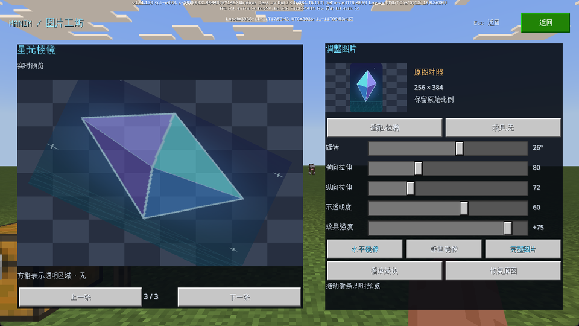
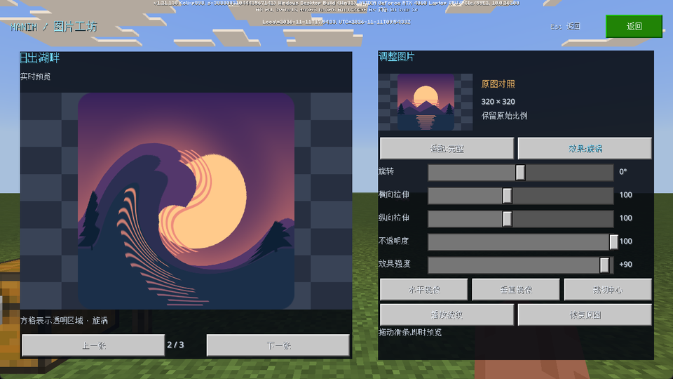

# ShaderImage：资源包图片与实时变形

`ShaderImage` 把已打包的普通 PNG 图片绘制到 Pyreact 局部 UI 控件中。图集、实体绑定和通用 shader 在构建时生成；游戏运行时通过参数控制图片，不生成新图片、不重编译 shader，也不调用全材质热重载。

## 游戏内体验

在主播放器点击 **图片变形**。左侧是可编辑图片，右侧保留独立原图作为比较。界面提供切换图片、完整显示／铺满裁切／拉满、旋转、横纵拉伸、透明度、镜像、局部裁剪、波纹／旋涡、波纹播放暂停和重置。关闭页面返回原播放器；回到游戏后可用 F8 打开播放器。

默认附带三张程序生成的普通 RGBA 图片：`aurora`、`sunrise`、`prism`。它们经过和自定义 PNG 相同的打包及采样路径，不是在游戏 shader 中重新绘制的测试图案。演示中方格表示透明背景。

## 业务接入

控制器由页面或业务模型持有，每个同时挂载的图片使用独立控制器。组件与现有 `ManimCanvas` 的两个槽位互不占用；当前另外提供四个图片槽位，第五个会明确报错。

```python
# MC 客户端 Python；需要已初始化 Pyreact。
from manim_ui.images import ShaderImage, create_image_controller
from manim_ui.pyreact import Component, Style


class PictureModel(object):
    def __init__(self):
        self.picture = create_image_controller(
            src="aurora", fit="contain", effect="wave", strength=0.8)

    def close(self):
        self.picture.dispose()


def start_picture(controller):
    controller.play()


@Component
def PictureCard(model):
    return ShaderImage(
        controller=model.picture,
        onReady=start_picture,
        style=Style(width=280, height=180, opacity=0.9, zIndex=2),
    )
```

`Style` 管理控件的位置、大小、显隐、叠放和继承透明度。图片内部的变换由控制器配置；运行时修改配置不需要重新创建控件：

```python
model.picture.configure(
    fit="fill", scale=(1.2, 0.8), rotation=0.4,
    flip_x=True, crop=(0.15, 0.15, 0.7, 0.7), opacity=0.75,
)
```

| 配置 | 含义 |
| --- | --- |
| `src` | 构建时注册的图片 ID；不是任意文件路径或 URL |
| `fit` | `contain` 等比完整包含；`cover` 等比铺满并裁切；`fill` 拉伸至控件比例 |
| `scale` | 两个 `0.0001..10000` 的数，分别缩放图片宽高；默认 `(1, 1)` |
| `rotation` | 绕图片中心旋转，单位弧度；屏幕坐标下正值顺时针 |
| `flip_x`、`flip_y` | 布尔值，分别镜像图片两个轴 |
| `crop` | 原图归一化矩形 `(左, 上, 宽, 高)`；宽高至少 `0.000001` 且整个区域在 `[0,1]` 内 |
| `opacity` | 0..1，与控件继承透明度相乘 |
| `effect` | `none`、`wave`、`swirl` |
| `strength` | -1..1；0 取消变形，负值反向 |

处理顺序为：选取原图裁剪区域 → 按该区域比例计算 fit → 独立缩放和镜像 → 围绕中心旋转；片元采样时再施加局部 UV 变形。最终内容始终限制在自身控件矩形内。启用父级裁剪时沿用原生纸娃娃的 scissor 行为，具体客户端和嵌套容器的裁剪效果需实机验证。旋转后超出矩形的部分不会自动扩张布局，需要业务增大控件或缩小图片。

波纹沿图片横向偏移采样坐标，最大位移为图片宽度的4%，纵向为三个周期，时间周期为1秒。旋涡围绕归一化图片中心，在半径0.5内渐变扭转；它由 `strength` 控制，不自动随时间旋转。非正方形图片的旋涡按图片归一化坐标计算。

| 方法 | 行为 |
| --- | --- |
| `configure(**changes)` | 校验整组参数后更新；非法参数不产生部分修改 |
| `play()` / `pause()` / `toggle_play()` | 控制波纹时钟；普通图片及静态旋涡无需逐帧上传时间 |
| `seek(seconds)` | 跳转波纹时间并暂停，方便对照中间态 |
| `reset()` | 恢复控制器创建时配置及0秒；演示页“重置”另保留当前所选图片 |
| `retry()` | 原生 API 失败后的显式重试 |
| `snapshot()` / `subscribe(callback)` | 查询／订阅配置、生命周期及错误；波纹每帧不会重建界面 |
| `dispose()` | 隐藏图片、注销帧回调并释放槽位；重复调用安全 |

配置可在挂载前准备；`onReady` 表示组件已经布局并完成首次参数提交。卸载会暂停并释放槽位，未销毁的控制器可再次挂载。所有操作仅在客户端线程使用。SDK 失败会隐藏图片并保留错误，不在每帧无限重试。

## 加入自己的图片

默认构建：

```powershell
& '.venv-reference/Scripts/python.exe' -B -X utf8 tools/build_shader_images.py
```

自定义资源清单是 ID 到配置的 JSON 映射，图片路径相对于清单所在目录：

```json
{
  "aurora": {"file": "images/my_card.png", "title": "我的图片"},
  "sunrise": {"file": "images/logo.png", "title": "透明标志"}
}
```

```powershell
& '.venv-reference/Scripts/python.exe' -B -X utf8 tools/build_shader_images.py --manifest my_images.json
```

构建后重新启动游戏以加载图集。构建器生成图片元数据、一个图集、四个实体绑定和共用材质，并保留其他材质。它会检查已生成资源是否被手动修改，避免覆盖未确认的编辑。图片使用静态 PNG，不支持 APNG。单张图片每边最多2044像素，打包时四周各留2像素间隔；整个图集最大为2048×2048。超过打包预算会报错，不自动缩小图片。默认1024×512 RGBA8图集的原始像素约2 MiB，最大图集约16 MiB，不包含引擎及驱动的额外开销。

控制器的 `src` 需与清单 ID 一致。内置演示页优先展示默认图片名，再列出其他注册图片；业务接入可以使用清单中的任意合法 ID。ID 使用小写字母开头，后接小写字母、数字或下划线，总长不超过48字符；清单最多64张图。自定义清单替换当前图集内容，不是追加；改回默认图集时重新执行不带 `--manifest` 的构建命令。

## 渲染与限制

- 同一个图片 shader 服务所有图片和实例；画面只在控件覆盖区域绘制，不使用全屏后处理遍历所有图片。
- 每个像素最多四次纹理读取，先预乘透明度再双线性插值，配合预乘混合避免透明 PNG 的隐藏颜色形成黑边／彩边；采样限制在当前图片／裁剪区域内，防止图集相邻图片串色。
- 静态配置缓存上传结果；普通波纹帧只更新时间所在的一组参数。屏幕与控件尺寸仅在布局变化时读取。
- 当前缩小图片使用双线性过滤，未实现 mipmap／各向异性过滤；强烈缩小的高频细节可能闪烁，旋转矩形的几何边界也未实现专门抗锯齿。
- 图片变形不改变原生 UI 的点击区域。需要精确命中扭曲后的轮廓，应另行实现命中映射。
- 图片的屏幕坐标在 Pyreact 布局提交后更新。原生滚动本身不一定触发布局提交，第一版不保证滚动容器内的图片持续跟随；演示页把两个图片固定在滚动区域外，只滚动参数控件。
- 不包含图片 A 到 B 的语义轮廓对应、任意网格折叠、运行时下载／创建新贴图、九宫格、完整 HTML／Flutter 渲染器。这些不应由图片采样能力自动推定。
- 桌面 GL 回归验证坐标与透明混合；游戏的纹理加载、原生裁剪与页面生命周期需要单独的实机证据。60 FPS 上限不代表所有图片数量和效果组合稳定达到60 FPS。

## 本次验证（2026-11-11）

90项相关离线检查通过：构建11项、图片GPU渲染13项、图片运行时18项、播放器生命周期31项、已有Canvas回归17项。GPU检查包含GLSL 330／400／450编译，以及方向、fit、旋转／镜像、裁剪、透明像素杂色、预乘混合和两种UV变形。四槽位隔离、耗尽、释放与复用属于离线运行时验证。

网易开发客户端3.10.0.448891、RTX 4060 Laptop上完成后台实机检查，保持60 FPS上限。真实画面确认三张PNG可显示；非等比拉伸、旋转、水平镜像、裁剪和半透明可组合，右侧原图保持独立；静态旋涡与波纹可显示。波纹播放时间推进，暂停后两次查询及窗口缩放后的时间均不再变化。

窗口从1917×1115调整为1280×720后，图片与控件重新布局正确；关闭页面后图片槽位从2降为0，播放器恢复；再次打开后两个实例均就绪。后台WGC截帧有新鲜帧校验，检查前后未激活游戏。按钮业务路径和状态通过SDK调用检查，物理鼠标／触屏拖动留待人工体验，没有将其计为已验收。

本实例MCDK日志检索没有发现shader编译失败、Python traceback或图片页面失败；存在8行与本组件无关的引擎初始化报错，未标记为全日志零错误。本次没有进行游戏帧率基准测试，也未扩大为手机、任意嵌套裁剪或滚动容器验收。

结构化记录见 [verification.json](evidence/shader-image/verification.json)。以下为真实游戏截图缩小至960×540的预览：




